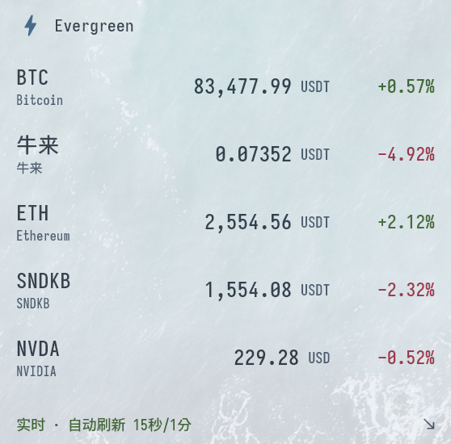
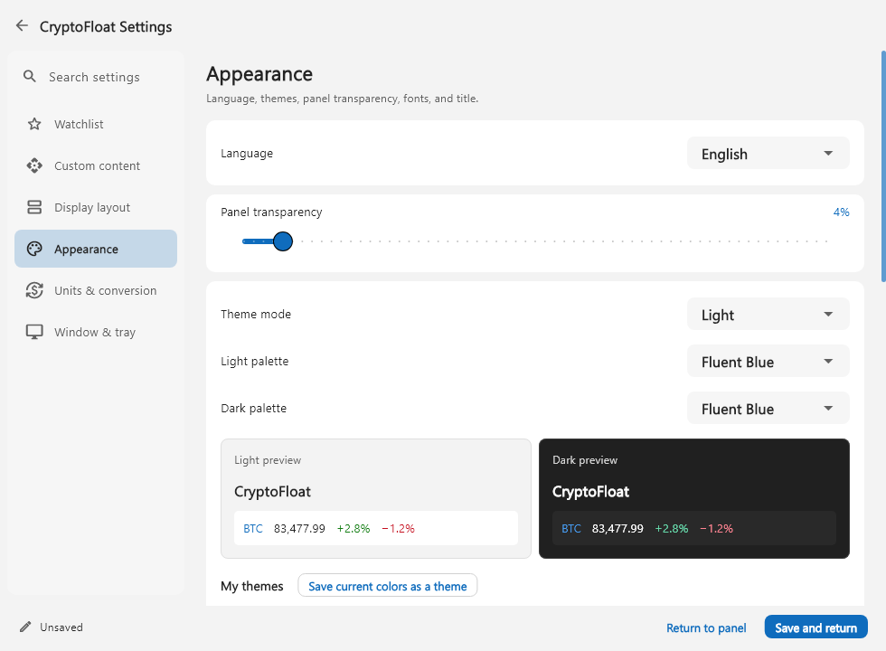

# DuoMonitor

[简体中文](README.md) · **English**

Show market quotes, JSON API fields, text, and local system metrics in a floating desktop panel and the Windows taskbar. Choose content and appearance independently for each display. Built with Flutter and Material 3, with English and Simplified Chinese interfaces.



Example appearance from v1.1: customize the name, fonts, colors, transparency, and displayed content. The settings interface has changed in the current version.

### Settings preview



The retained v1.2 screenshot illustrates the appearance; v1.3 adds display targets and system monitoring, v1.4 adds columns and entry orientation, and v1.4.1 adds Save without leaving Settings and compact taskbar options. This preview uses sample data. Watchlist selections stay in place while editing; selected items move to the top when reopening the page or refreshing the catalog.

## Download and run

Download **DuoMonitor-Windows-x64-1.6.0.zip** from [Releases](https://github.com/Jaron-admin/DuoMonitor/releases).

Extract the entire archive and run `duomonitor.exe`. Keep `duomonitor_taskbar.exe`, the accompanying libraries, and the `data` folder beside it. The taskbar helper starts and exits with the main app.

Portable mode is the default: settings, caches, imported icons, protected secrets, and diagnostic logs live in `user_data` beside the executable. **Settings → Import & data location** can switch to the Windows system app-data folder `%APPDATA%\DuoMonitor`, with an option to copy the current data. Only one instance runs for the current Windows user in the current login session; launching again brings it forward. Exit the old version and back up the active data folder before upgrading; in portable mode, keep `user_data` beside the new app. Previously saved custom titles, icons, themes, and display content are retained.

The current release provides a **Windows x64** build. macOS and Linux project scaffolds are included, but their native window and protected storage integrations are incomplete. Android and iOS releases are not available.

Right-click the floating panel to open Settings. Select **Settings → Appearance → Language** to use English, Simplified Chinese, or the system language. Floating panel transparency is also available under Appearance.

## Features

- The floating market panel and taskbar monitoring start enabled; the taskbar's default selection is CPU, memory percentage, upload, and download rates.
- Each display independently selects quotes, API fields, text templates, and system metrics, with its own order, fonts, colors, and units. Data sources and device choices are shared.
- Transparent taskbar background, compact one/two-row layouts, automatic width within verified free space, and configurable label/value and item spacing. Choose short or custom labels; hover for original names and values.
- CPU, memory, GPU, video memory, network rates, and disk read/write rates, with a 1–60 second sample interval and automatic or manual device selection.
- Cryptocurrency, US stock, and selected mainland China stock quotes, with prices, changes, units, and update status.
- Searchable OKX, Binance, and KuCoin trading-pair catalogs. Reorder your watchlist by dragging or using move-up and move-down buttons.
- Custom HTTPS JSON APIs, fields, and display templates. Built-in quotes and free-form text can appear together.
- Unit aliases, reference exchange-rate conversion, and custom multipliers. Starter templates cover weather, exchange rates, public repository statistics, and text reminders.
- Light, dark, and system themes, multiple named color presets, and a visual color picker.
- Custom system fonts, numeric fonts, transparency, text size, spacing, app name, and icon.
- A 1–8 column floating layout with horizontal or vertical entries and right-aligned values. The 24h percentage can be hidden independently.
- Shared price colors for both displays: default text, theme up/down colors, green-up, or red-up. Direction compares consecutive successful refreshes; the first refresh is neutral.
- Context menu, always-on-top window, double-click to hide to the tray, click to restore, and per-monitor DPI support.
- English and Simplified Chinese interfaces, with manual or system language selection.

Select **Floating panel** or **Taskbar** in Settings; the fixed live preview renders the current draft. **Display layout** controls columns, orientation, spacing and the 24h percentage. Price colors compare refreshes, while each 24h percentage uses its own sign. **Price display precision** offers standard or K/M/B notation and automatic or 0–8 decimals per asset, such as `81.7K`. **Taskbar layout** controls rows, background, spacing, labels and overflow behavior. Width follows the content and verified free space without an arbitrary cap. Overflow pages support the mouse wheel and automatic rotation, with a configurable 2–60 second interval (default 5). Hover and manual scrolling pause rotation. Formatting and layout are stored separately for each display.

**Save** commits changes and keeps Settings open. Clicking outside Settings or returning to the panel still saves automatically and briefly confirms success. A close request during a save waits for that operation; a failed save keeps the draft for retry. Alt+Tab and color, font, or file pickers do not close Settings. Only Settings has an application taskbar button. Closing Settings saves and returns to the panel; closing the floating panel hides it to the tray. Use **Exit** to end the app.

Taskbar integration targets the standard primary Windows taskbar. It attempts to display only when a usable region can be confirmed and has enough room. Unsupported layouts, insufficient space, and an unavailable taskbar pause the display; Settings shows the helper's reported state. v1.4 fixes the reproduced Windows 11 composition issue that hid taskbar content, with visible metrics confirmed on one real desktop setup. Other configurations still need testing; the reported state alone does not verify visible content. Windows 11 has no supported third-party reserved slot, so every layout cannot be guaranteed. Taskbar content provides a context menu with settings, refresh, show floating panel, disable taskbar, and exit actions. The tray remains a way to restore the floating panel.

Missing metrics and samples establishing a baseline show `—`; only valid zero values show `0`. Automatic network selection uses active physical interfaces; manual selection can include virtual interfaces. GPU usage represents the busiest engine on the selected adapter; a memory percentage is unavailable when its capacity cannot be established. Rates need a new baseline after startup, resume, or a device change. Compatibility with the real taskbar still requires validation for the particular Windows version and desktop layout.

With centered Windows taskbar icons, data prefers sufficient far-left free space, otherwise the widest verified gap. Weather, widgets and other controls remain excluded. If free space cannot be reliably verified, the display pauses.

v1.4.1 corrects a DPI transition that reused the old display's minimum size and changed the window's logical width; the native regression passes. See the [DPI investigation](docs/verification/dpi-investigation.md) for live observations and verification limits.

## Data and settings

The app remembers the selected data location. Existing portable installs continue to read their own `user_data` until a choice is saved. An active folder without settings starts with defaults; old `%APPDATA%\CryptoFloatFlutter` or `%LOCALAPPDATA%\CryptoFloat\secrets` data is not read automatically. Preserve the complete active data folder when moving or backing up the app. Share the original release ZIP, which excludes personal data and storage-location markers.

Secret request headers are protected using Windows DPAPI for the current user. Enter those secrets again after moving to another computer or Windows account. Connections follow the Windows system network settings.

Public data may be delayed, rate-limited, or temporarily unavailable. “Live” means the app fetched data successfully within the configured interval; it does not guarantee zero market-data latency. Prices and exchange rates are for reference.

See the [usage and build guide](flutter_app/README.en.md) for details.

See the [changelog](CHANGELOG.md) for this release.

## Build from source

Use Flutter 3.47.5 / Dart 3.13.4 and the Visual Studio desktop development with C++ toolchain. Follow the [Flutter Windows setup guide](https://docs.flutter.dev/platform-integration/windows/setup).

```powershell
git clone https://github.com/Jaron-admin/DuoMonitor.git
cd DuoMonitor/flutter_app
flutter pub get
flutter build windows --release
```

To create a release folder and ZIP containing the usage guides and licenses:

```powershell
./tool/build_windows.ps1 -PackageName DuoMonitor-Windows-x64-1.6.0
```

## License

DuoMonitor's own source code is licensed under the [MIT License](LICENSE). You may use, modify, distribute, and use it commercially while retaining the license and copyright notice.

Dependencies and fonts retain their own licenses. See [Third-party notices](THIRD_PARTY_NOTICES.md). Release packages include the project license and full third-party license texts.
