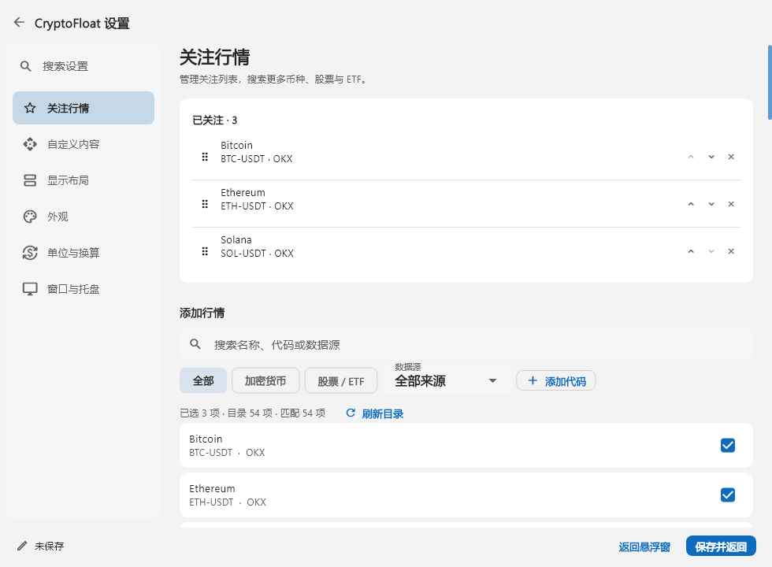

# MetricPerch · 数栖

**简体中文** · [English](README.en.md)

在桌面悬浮窗和 Windows 任务栏中显示行情、自定义 API 字段与本机系统数据。两处独立选择内容和外观。使用 Flutter 和 Material 3 构建，支持简体中文和 English。


v1.1 外观示例：名称、字体、配色、透明度和显示内容均可自定义；新版设置界面有所调整。

### 设置界面示例



保留 v1.2 的设置截图供外观参考；v1.3 新增显示目标和系统监测设置，v1.4 新增列数与排列方式，v1.4.1 增加保存后留页和任务栏紧凑显示选项。上图使用示例数据；勾选时列表保留原位置，重新进入页面或刷新目录后再把已选项目排到前面。

## 下载与启动

前往 [Releases](https://github.com/Jaron-admin/MetricPerch/releases) 下载 **MetricPerch-Windows-x64-1.4.1.zip**。

解压整个压缩包，双击 `metricperch.exe` 启动。请保留同目录的 `metricperch_taskbar.exe`、运行库和 `data` 文件夹，不能只复制主 EXE。任务栏宿主随主程序启动和退出。

这是便携版：设置、缓存、导入图标、受保护的密钥和任务栏诊断日志保存在程序旁的 `user_data` 文件夹。解压到可写目录；移动程序时带上整个目录。同一 Windows 用户的当前登录会话只运行一个实例，再次启动会唤回已有窗口。升级前退出旧版，在新程序目录中保留自己的 `user_data`；原 CryptoFloat 便携设置会迁移，自定义标题、图标、主题和显示内容保留。

当前发行版支持 **Windows x64**。macOS/Linux 已有项目骨架，尚未完成原生窗口和受保护存储适配；Android/iOS 暂无可用发行版。

## 功能

- 默认同时启用行情悬浮窗与任务栏系统监测；任务栏默认选择 CPU、内存百分比、上传和下载速率。
- 悬浮窗和任务栏各自选择行情、API 字段、文字模板和系统指标，独立排序、字体、颜色和单位；共享数据源与设备选择。
- 任务栏支持透明背景、紧凑单行/双行、最大宽度和项目间距；可用自动简写或逐项自定义名称，悬停查看原始名称与数值。
- 系统任务栏居中对齐时，数据靠最左侧可用空白排列，避开天气和小组件；左侧空间不足时暂停。系统任务栏左对齐时使用右侧空白。
- CPU、内存、GPU、显存、网速和磁盘读写监测，采样间隔 1–60 秒，支持自动或手动选择设备。
- 加密货币、美股和部分沪深股票行情，显示价格、涨跌幅、单位与更新状态。
- 自动获取 OKX、Binance、KuCoin 交易对目录，搜索和勾选关注项目；支持拖拽排序和上下移动。
- 自定义 HTTPS JSON API、字段与显示模板，默认行情和自由文本可同时显示。
- 单位简写、参考汇率换算、自定义倍率；提供天气、汇率、公开仓库统计和文字提醒模板。
- 浅色、深色与跟随系统主题，多套命名配色预设和可视化取色器。
- 系统字体及数字字体、透明度、字号、间距、名称和图标自定义。
- 悬浮窗支持 1–8 列，每项可横向或纵向排列；24h 涨跌幅可隐藏，价格用自定义涨跌颜色表示方向。
- 右键菜单、窗口置顶、双击隐藏到托盘、单击托盘恢复，多显示器 DPI 适配。

右键悬浮窗打开设置。在 **设置 → 外观 → 语言** 中选择简体中文、English 或跟随系统；悬浮窗透明度也位于“外观”中。

在设置中先选择 **悬浮窗** 或 **任务栏**，再编辑当前显示的内容和外观。“显示布局”提供列数、项目排列方式和涨跌显示选项。“任务栏布局”可单独启停，调整最大宽度、单行/双行、透明背景、项目间距和名称显示。短内容按实际宽度收窄；自定义简写只影响任务栏，不修改原始数据。系统设备和采样间隔对两处共享。

点击 **保存** 会提交更改并留在设置页；点击设置窗口外或返回悬浮窗仍会自动保存，成功后短暂提示。保存中收到关闭请求会等待当前保存完成；失败保留草稿供重试。Alt+Tab 和取色、字体、文件选择窗口不会触发自动关闭。设置页显示独立的任务栏按钮；关闭设置窗口会保存后返回悬浮窗，关闭悬浮窗会隐藏到托盘，需要结束程序时使用 **退出**。

任务栏首期面向 Windows 主屏标准任务栏。只有确认可用区域且空间足够时才尝试显示；空间不足、不支持的布局或任务栏尚未就绪时暂停，设置中显示宿主报告的状态。v1.4 修复了已复现的 Windows 11 任务栏合成导致内容不可见的问题，并在一套真实桌面配置中确认指标可见；其他配置仍需验证，宿主状态本身不代表实际画面已验证。Windows 11 没有受支持的第三方预留位置，无法保证每种布局可用。任务栏内容提供右键菜单，可打开设置、刷新、显示悬浮窗、关闭任务栏或退出；托盘仍可恢复悬浮窗。

系统指标缺失或正在建立采样基线时显示 `—`，有效零值才显示 `0`。网卡自动模式统计活动物理接口，手动模式可选虚拟接口；GPU 显示所选适配器的最忙引擎，无法确定显存容量时不计算百分比。启动、恢复和切换设备后，速率需等待新的采样基线。真实任务栏兼容性仍需结合具体 Windows 版本与桌面布局验证。

v1.4.1 修正了跨屏 DPI 过渡中沿用旧屏最小尺寸、导致窗口逻辑宽度变化的问题，对应原生回归已通过。跨屏复测结果和验证范围见 [DPI 调查记录](docs/verification/dpi-investigation.md)。

## 数据与配置

没有 `user_data` 时使用默认配置，不会自动读取或迁移 Windows 用户目录中的旧版数据，旧文件保持原样。已使用过的便携版下次启动继续读取自己的 `user_data`。分享程序请使用发行 ZIP，或先移除分享副本中的 `user_data`，避免分享个人配置。

API 请求头密钥由 Windows 当前用户的 DPAPI 保护；换电脑或 Windows 账户后需要重新输入密钥。网络自动跟随 Windows 系统网络设置。

公开行情可能延迟、限流或暂时不可用；“实时”表示应用在设定周期内成功获取数据。价格与汇率仅供展示参考。

完整说明见 [使用与构建文档](flutter_app/README.md)。

本次变化见 [更新记录](CHANGELOG.md)。

## 从源码构建

需要 Flutter 3.47.5 / Dart 3.13.4，以及支持 C++ 桌面开发的 Visual Studio 工具链。

```powershell
git clone https://github.com/Jaron-admin/MetricPerch.git
cd MetricPerch/flutter_app
flutter pub get
flutter build windows --release
```

工具链安装步骤见 [Flutter Windows 配置文档](https://docs.flutter.dev/platform-integration/windows/setup)。生成包含使用说明与许可证的发布目录和 ZIP：

```powershell
./tool/build_windows.ps1 -PackageName MetricPerch-Windows-x64-1.4.1
```

## 开源协议

MetricPerch 自有源码使用 [MIT License](LICENSE)，允许使用、修改、分发和商业使用，分发时保留许可证与版权声明。

第三方依赖和字体分别遵循各自的条款，详见 [第三方许可说明](THIRD_PARTY_NOTICES.md)。发布包附带项目许可证及第三方完整许可文本。
